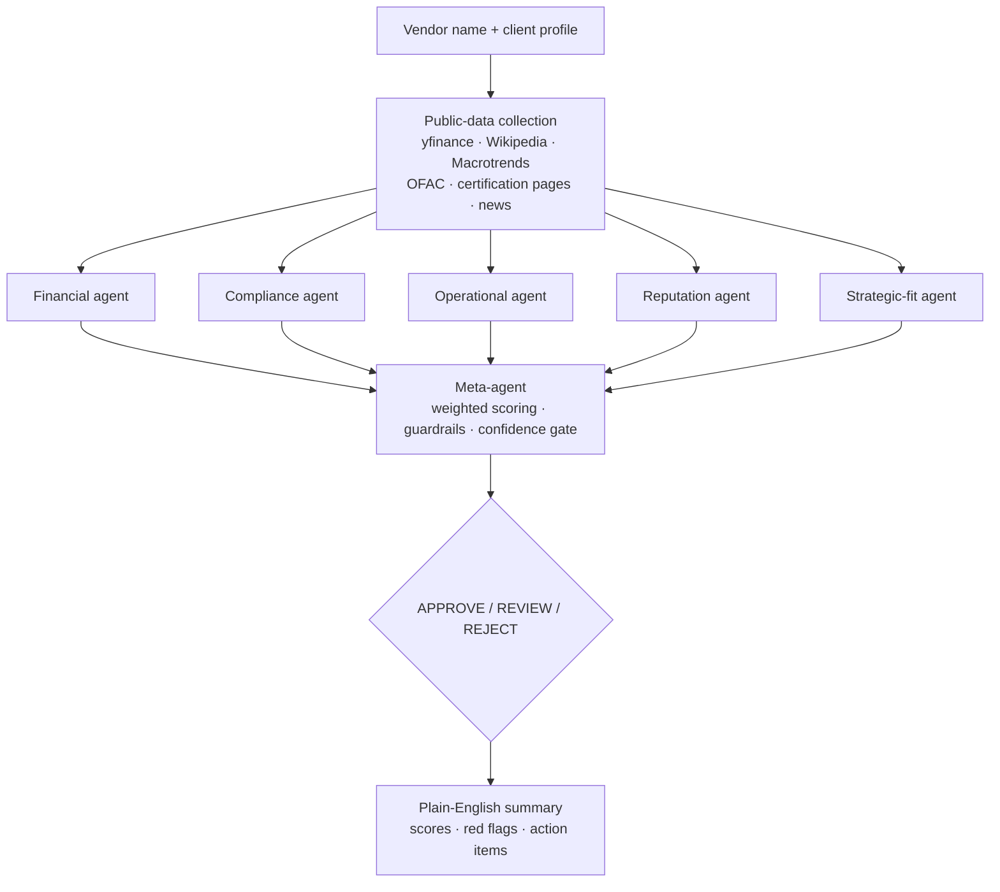

<p align="center">
  
</p>

<h1 align="center">VendorIQ</h1>

<p align="center">
  <b>Multi-agent vendor risk and due-diligence platform</b><br>
  Five specialised AI agents assess a vendor, and a meta-agent combines their findings into an
  <b>Approve / Review / Reject</b> recommendation with evidence, confidence scores and red flags.
</p>

<p align="center">
  
  
  
  
  
</p>

---

## Overview

Vendor due diligence means reviewing a supplier's financial health, regulatory compliance, operational capability, reputation and strategic fit. Gathering that information from many sources and turning it into a consistent, auditable decision is slow and hard to standardise.

VendorIQ automates the **first pass**. Given a vendor name, it collects publicly available data, runs five domain agents over it, and produces a structured assessment in which every score is backed by cited evidence. Deterministic rules sit on top of the model outputs so critical compliance checks are not left to the LLM alone.

> VendorIQ is a decision-support tool. Its recommendations are meant to inform human reviewers, not replace them.

## How it works



1. **Collect.** The scraper gathers financial metrics, company age, sanctions status, certifications and news signals, tagging each data point with its source.
2. **Assess.** Five domain agents each evaluate one dimension of vendor risk.
3. **Synthesise.** The meta-agent combines agent scores using configurable weights, applies hard rules, and writes the final recommendation.

### The five agents

| Agent | What it evaluates |
|---|---|
| **Financial** | Liquidity, solvency, profitability, revenue stability, credit indicators |
| **Compliance** | Certifications (e.g. SOC 2, ISO 27001), OFAC sanctions, regulatory actions |
| **Operational** | Scale, continuity and delivery capability |
| **Reputation** | News signals, track record, certifications |
| **Strategic fit** | Alignment with the client's priorities, dealbreakers and preferences |

### Two-pass agent design

Every agent runs in two steps:

1. **Reasoning pass.** The model analyses the domain data and must cite the source of every figure it uses, e.g. `current ratio of 1.4 [Yahoo Finance]`.
2. **Scoring pass.** Using that reasoning, the model returns a structured JSON object:

```json
{
  "score": 82.5,
  "confidence": 0.88,
  "explanation": "...",
  "evidence": ["current_ratio: 1.4 [Source: Yahoo Finance / yfinance]"],
  "red_flags": []
}
```

Separating reasoning from scoring keeps each number traceable to its evidence and makes the structured output more reliable.

### Decision logic

The meta-agent combines agent scores with configurable weights (defaults below). If an agent fails, its weight is redistributed across the others so the assessment still completes.

| Dimension | Default weight |
|---|---|
| Financial | 30% |
| Compliance | 25% |
| Operational | 20% |
| Strategic fit | 15% |
| Reputation | 10% |

It also reports a separate **Risk score** (financial + compliance) and **Strategic-fit score** (strategic + operational + reputation), then applies rules in this order:

| Condition | Result |
|---|---|
| OFAC sanctions match | **REJECT** (hard override) |
| Average confidence below 95% | **REVIEW** (route to a human) |
| Composite score ≥ 70 | **APPROVE** |
| Composite score 45–69 | **REVIEW** |
| Composite score < 45 | **REJECT** |

Action items in the final report are generated from the actual red flags, e.g. requesting missing certifications or a legal review of regulatory actions.

## Engineering highlights

- **Source-grounded evidence.** Data points carry their origin through to the final report, giving an auditable trail.
- **Deterministic guardrails.** Sanctions and confidence rules are enforced in code, on top of the LLM scores.
- **Graceful degradation.** A failed agent's weight is redistributed instead of failing the whole run.
- **Resilient JSON parsing.** Model output is cleaned and extracted, with a safe fallback object if parsing fails.
- **Reproducible output.** `temperature=0` and greedy decoding for consistent structured results.

## Tech stack

**Python** · **IBM watsonx** (`langchain-ibm` / `ChatWatsonx`) · **LangChain** · **Llama 3.3 70B Instruct** · **yfinance** · **BeautifulSoup** · **asyncio**

## Getting started

**Requirements:** Python 3.10+, an IBM watsonx project with access to `meta-llama/llama-3-3-70b-instruct`, and internet access for the data collectors.

```bash
# 1. Clone
git clone https://github.com/aishwaryapurohit15/vendoriq.git
cd vendoriq

# 2. Install dependencies
pip install -r requirements.txt

# 3. Add your IBM watsonx credentials
cp backend/.env.example backend/.env
#    then set IBM_API_KEY, WATSONX_PROJECT_ID and WATSONX_URL in backend/.env

# 4. Run the full pipeline
cd backend
python test_all_agents.py
```

To assess a different vendor, change `VENDOR_NAME` and `CLIENT_PROFILE` at the top of `backend/test_all_agents.py`.

## Project structure

```
vendoriq/
├── assets/                    # cover image
├── backend/
│   ├── app/
│   │   ├── agents/            # base agent, 5 domain agents, meta-agent
│   │   ├── orchestrator/      # VendorRiskState schema
│   │   ├── services/          # scraper.py (public-data collection)
│   │   └── config_watsonx.py  # watsonx model setup
│   ├── test_all_agents.py     # end-to-end pipeline runner
│   ├── test_financial_agent.py
│   └── .env.example
├── requirements.txt
└── README.md
```

## Limitations

- Coverage is strongest for **publicly listed companies**; private vendors have less public financial data.
- The operational agent works mainly from proxies (company size, industry, growth) since SLA and continuity data is rarely public.
- Scrapers depend on third-party page layouts and may need updating if those sites change.
- Outputs are a first-pass screen and should be reviewed by a procurement professional.

## Team

Built for the **IBM watsonx Challenge** by:

- [@aishwaryapurohit15](https://github.com/aishwaryapurohit15)
- [Harsh Motiramani (@Harshmm2003)](https://github.com/Harshmm2003)
